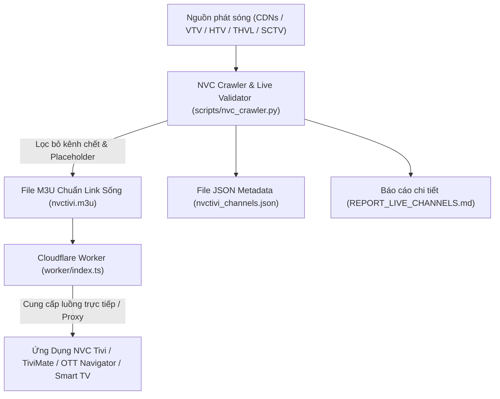

# 📺 NVC Tivi - Hệ Thống Quản Lý & Tự Động Crawl Kênh Truyền Hình Việt Nam

<div align="center">


**Hệ thống playlist M3U thông minh, tự động lọc link chết, cập nhật luồng phát sóng Full HD 1080p từ các đài truyền hình Việt Nam cho ứng dụng NVC Tivi.**

</div>

---

## 🌟 Tính Năng Nổi Bật

- 🎯 **100% Link Sống (Live Verified)**: Tự động kiểm tra HTTP status, phân tích header và xác thực luồng HLS/m3u8 thực tế để loại bỏ toàn bộ kênh chết hoặc ảnh tĩnh cảnh báo offline (`signal_low`).
- ⚡ **Đa Nguồn Dự Phòng (Multi-Source Fallback)**: Tích hợp nhiều CDN tốc độ cao (FPT VNNS 1080p, VTV Digital, đài phát thanh truyền hình địa phương) giúp tự động chuyển luồng dự phòng khi luồng chính gặp sự cố.
- 🚀 **Cloudflare Worker API Thông Minh**:
  - Hỗ trợ tải playlist trực tiếp qua URL: `/playlist.m3u` (hoặc `/playlist.m3u?proxy=1` để proxy qua worker).
  - Tích hợp công cụ tìm kiếm kênh tức thì: `/search?q=vtv1`.
  - Phân loại danh mục kênh theo nhóm: `/groups`.
  - Hỗ trợ đầy đủ CORS, giải mã DRM, bảo vệ nguồn luồng và giảm độ trễ khi chuyển kênh.
- 📺 **Chuẩn Hoá Toàn Diện**:
  - Tích hợp lịch phát sóng điện tử (EPG): `url-tvg="https://epgvn.vercel.app/epg.xml,https://epg.io.vn/epgc.xml"`.
  - Đồng bộ chuẩn thẻ `tvg-id`, `tvg-name`, `tvg-logo`, `group-title`.
  - Kho 170+ biểu trưng (logo) sắc nét chuẩn tỷ lệ tại thư mục `logos/`.

---

## 🏗️ Kiến Trúc Hệ Thống NVC Tivi



---

## 📋 Danh Mục Kênh Chuẩn Hoá Trên NVC Tivi

Hệ thống được sắp xếp khoa học thành các nhóm kênh phục vụ mọi nhu cầu giải trí của gia đình:

| STT | Nhóm Kênh | Số Kênh Hoạt Động | Các Kênh Tiêu Biểu |
| :---: | :--- | :---: | :--- |
| **1** | **⭐️ VTV - Kênh Thiết Yếu** | **13** | VTV1 HD (1080p), VTV2 HD (1080p), VTV3 HD (1080p), VTV4, VTV5, VTV5 Tây Nam Bộ, VTV5 Tây Nguyên, VTV Cần Thơ, VTV7, VTV8, VTV9, VTV10, Vietnam Today |
| **2** | **📺 HTV - HTVC TP.HCM** | **12** | HTV1 HD, HTV2 HD, HTV3, HTV7 HD, HTV9 HD, HTVC Thuần Việt, HTVC Gia Đình, HTVC Phim HD, HTVC Phụ Nữ, HTVC Du Lịch, HTVC Ca Nhạc, HTVC Plus |
| **3** | **🎬 Truyền Hình Vĩnh Long** | **4** | THVL1 HD (1080p), THVL2 HD (1080p), THVL3 HD, THVL4 HD |
| **4** | **📡 Kênh Quốc Gia & An Ninh** | **2** | ANTV HD (Truyền hình Công an ND 1080p), QPVN HD (Truyền hình Quốc phòng VN) |
| **5** | **🎥 Truyền Hình Cáp SCTV** | **15** | SCTV2, SCTV3, SCTV4, SCTV6, SCTV7, SCTV9, SCTV11, SCTV12, SCTV13, SCTV14, SCTV16, SCTV18, SCTV19, SCTV20, SCTV22 |
| **6** | **⚽ Thể Thao Đặc Sắc** | **4** | SCTV15 (Thể Thao), SCTV17 (Thể Thao), HTV Thể Thao HD, ON GOLF |
| **7** | **🎬 Phim Truyện & Giải Trí** | **7** | ON Cine, On Movies, ON Vie Giải Trí, ON Vie Dramas, On Music, On O2TV, ON Info TV |
| **8** | **👧 Thiếu Nhi & Gia Đình** | **1** | On Kids |
| **9** | **🏛️ Truyền Hình Địa Phương** | **16** | Hà Nội 1, Hải Phòng, Cà Mau, Bình Thuận, Tuyên Quang, Thái Nguyên, Quảng Ninh 1, Quảng Ninh 3, Bắc Ninh, Phú Thọ, Sơn La, Điện Biên, Hưng Yên, Ninh Bình, Nghệ An, Tây Ninh... |
| **10** | **🌐 Kênh Quốc Tế Chọn Lọc** | **8** | NHK World Japan, NHK Premium, France 24, DW - Deutsche Welle, Channel News Asia, TV5 Monde, Arirang TV HD, VBS TV HD |

---

## 🚀 Hướng Dẫn Sử Dụng

### 1. Dành cho người dùng cuối (App NVC Tivi, TiviMate, OTT Navigator, VLC)

Bạn có thể dán trực tiếp đường dẫn M3U sau vào bất kỳ ứng dụng xem IPTV nào:

* **Danh sách phát chuẩn trực tiếp (Tối ưu tốc độ tải):**
  ```text
  https://raw.githubusercontent.com/<your-username>/nvctivi/main/nvctivi.m3u
  ```

* **Danh sách phát qua Cloudflare Worker (Có Proxy & tự động làm mới):**
  ```text
  https://<your-worker-subdomain>.workers.dev/playlist.m3u
  ```

* **Tùy chọn lọc theo nhóm kênh:**
  ```text
  https://<your-worker-subdomain>.workers.dev/playlist.m3u?group=VTV
  ```

---

### 2. Dành cho lập trình viên (Developer Guide)

#### Bước 1: Chạy công cụ Crawl và kiểm tra link sống cục bộ
Chạy script tự động quét và lọc kênh:
```bash
python scripts/nvc_crawler.py
```
*Kết quả:* Script sẽ sinh ra file `nvctivi.m3u`, `nvctivi_proxy.m3u`, `nvctivi_channels.json` và bảng thống kê `REPORT_LIVE_CHANNELS.md`.

#### Bước 2: Kiểm tra tính hợp lệ của Playlist
```bash
python scripts/update.py --validate-only
```

#### Bước 3: Triển khai Cloudflare Worker
1. Cài đặt các thư viện Node.js:
   ```bash
   npm install
   ```
2. Kiểm tra mã nguồn Worker:
   ```bash
   npm run check
   ```
3. Deploy lên Cloudflare Workers:
   ```bash
   npm run deploy
   ```

---

## ⚙️ Các Endpoint Của Cloudflare Worker

| Phương thức | Đường dẫn | Mô tả chức năng |
| :---: | :--- | :--- |
| `GET` | `/` hoặc `/health` | Kiểm tra tình trạng hoạt động của Worker và số lượng kênh khả dụng |
| `GET` | `/playlist.m3u` | Cung cấp toàn bộ danh sách M3U chuẩn cho app |
| `GET` | `/playlist.m3u?proxy=1` | Cung cấp M3U với các luồng phát định tuyến qua Worker Proxy |
| `GET` | `/playlist.m3u?group=VTV` | Lọc danh sách kênh theo từng nhóm (VTV, HTV, SCTV...) |
| `GET` | `/search?q=vtv1` | API tìm kiếm thông tin kênh và link phát dưới định dạng JSON |
| `GET` | `/groups` | Thống kê số lượng kênh theo từng nhóm danh mục |
| `GET/POST`| `/channel?name=...` | Điều hướng (302) hoặc proxy luồng phát cho từng kênh cụ thể |

---

## 🔄 Tự Động Hoá Bằng GitHub Actions

Dự án đã được tích hợp sẵn quy trình **GitHub Actions** (`.github/workflows/sync.yml`) tự động chạy mỗi 4 tiếng:
1. Tự động crawl và kiểm tra mọi liên kết streaming trong hệ thống.
2. Tự động loại bỏ link chết và cập nhật luồng mới nhất.
3. Tự động mã hóa và cập nhật `nvc.enc` đồng bộ.
4. Tự động commit và đẩy các file M3U mới nhất lên kho lưu trữ.
5. **Tự động ghi đè danh sách kênh sống vào repository `NVC-IPTV`** (`api/iptv/link0.m3u`) khi có cấu hình Secret `NVC_PAT`.

### Hướng dẫn cấu hình tự động đồng bộ sang NVC-IPTV
Để Action tự động ghi đè file `api/iptv/link0.m3u` trên repo `nvchienspt-maker/NVC-IPTV`:
1. Vào **GitHub Settings** của bạn $\rightarrow$ **Developer Settings** $\rightarrow$ **Personal access tokens** $\rightarrow$ **Tokens (classic)**.
2. Bấm **Generate new token (classic)**, đặt tên (ví dụ: `NVC_SYNC_TOKEN`), chọn quyền **`repo`** (Full control of private repositories) rồi bấm **Generate token** và sao chép mã token.
3. Vào repo **`m3u`** $\rightarrow$ **Settings** $\rightarrow$ **Secrets and variables** $\rightarrow$ **Actions** $\rightarrow$ Bấm **New repository secret**.
4. Đặt Name là: `NVC_PAT` và dán mã token vừa copy vào Value $\rightarrow$ Bấm **Add secret**.
*Từ lần chạy tiếp theo, GitHub Action sẽ tự động đồng bộ và ghi đè nội dung kênh sống sang `api/iptv/link0.m3u` trên repo NVC-IPTV!*

---

## 🛡️ Tuyên Bố Miễn Trừ Trách Nhiệm

* Dự án **NVC Tivi** không lưu trữ, phân phối hay tạo ra bất kỳ nội dung đa phương tiện nào.
* Toàn bộ các đường dẫn luồng phát (streaming links) được thu thập và tổng hợp từ các luồng phát thanh/truyền hình công khai trên Internet của các đài truyền hình tại Việt Nam.
* Vui lòng tôn trọng quyền tác giả và sở hữu trí tuệ của các đơn vị truyền thông.
